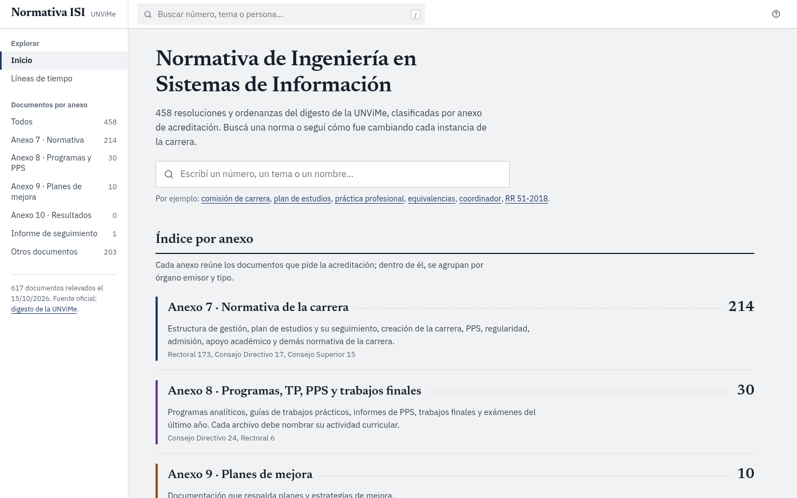
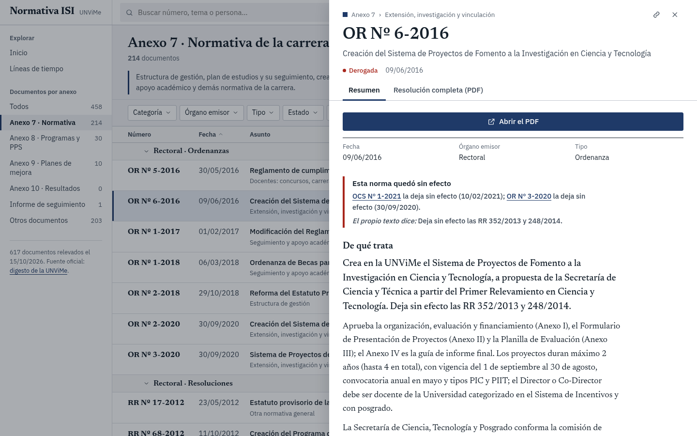
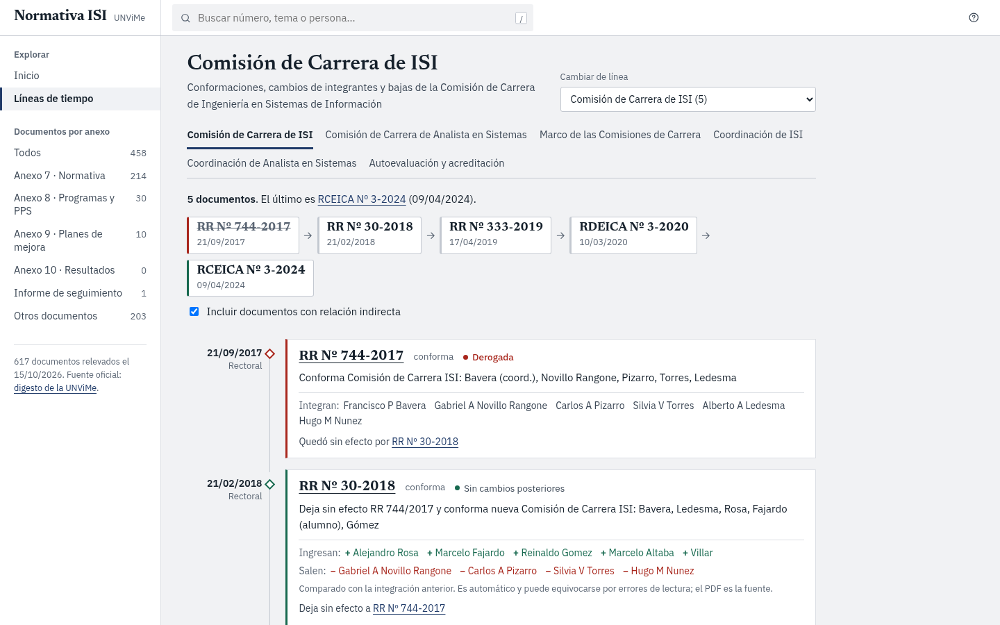
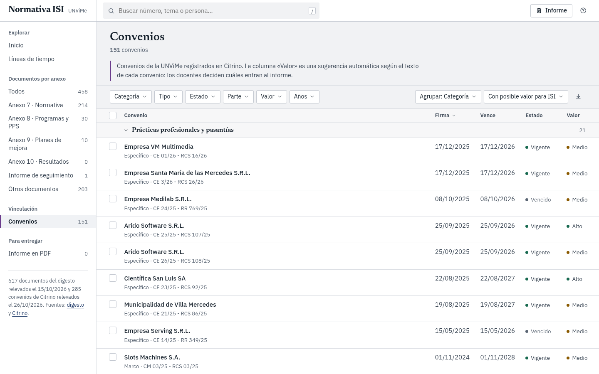
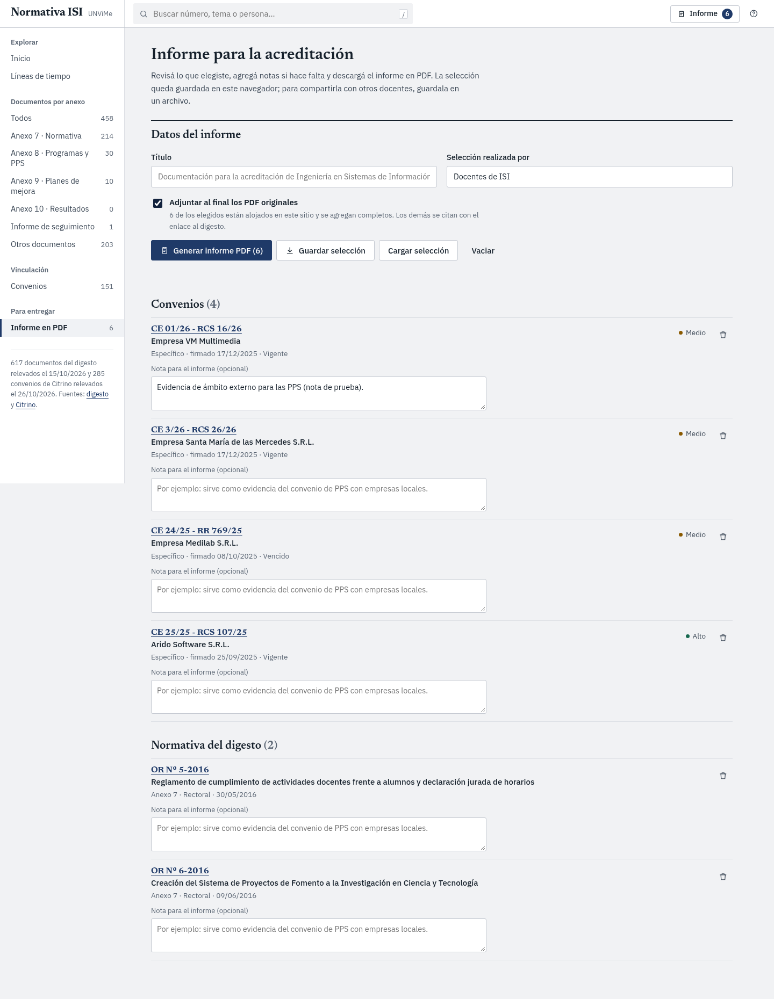

# Normativa ISI · UNViMe

Visor de la normativa de la carrera **Ingeniería en Sistemas de Información** de la Universidad Nacional de Villa Mercedes, organizada para armar la presentación de acreditación.

**Versión publicada:** https://flordelcastillo.github.io/normativa-isi-unvime/



## Para qué sirve

El digesto de la UNViMe tiene más de 13.000 resoluciones y ordenanzas escaneadas, con un buscador que sirve poco. Este proyecto leyó con OCR las que podían corresponder a la carrera, se quedó con las relevantes y las ordenó según los anexos que pide la CONEAU:

| Anexo | Qué reúne | Documentos |
|---|---|---|
| 7 | Normativa de la carrera: gestión, plan de estudios, PPS, regularidad, ingreso, apoyo académico | 267 |
| 8 | Programas, trabajos prácticos, informes de PPS y trabajos finales | 30 |
| 9 | Respaldo de planes y estrategias de mejora | 26 |
| Informe de seguimiento | Compromisos asumidos en una acreditación anterior | 1 |
| Otros | Designaciones, concursos y actividades de la Escuela | 293 |

El Anexo 10 (análisis de resultados e informes de seguimiento) queda vacío: el digesto no publica esos informes, hay que buscarlos fuera de él.

Cada documento se puede ver por **anexo, órgano emisor y tipo**, con su resumen y el PDF. Además:

- **Líneas de tiempo.** La cadena de resoluciones de una instancia (por ejemplo, la Comisión de Carrera: 744-2017, 30-2018, 333-2019, RDEICA 3-2020 y RCEICA 3-2024) con quién entra y quién sale en cada etapa.
- **Vigencia.** Si otra norma la modifica, la rectifica o la deroga, se ve en la propia ficha.
- **Exportación** de cualquier lista a una planilla.




## Convenios

Además de la normativa del digesto, el visor incluye los 285 convenios registrados en [Citrino](http://citrino.unvime.edu.ar/citrino/#/convenios) (se leyeron con el acceso público del propio sistema). Cada convenio tiene sus datos (partes, tipo, firma, vencimiento, expediente), un resumen hecho a partir del PDF escaneado y una sugerencia de **valor para la acreditación de ISI** (alto, medio o bajo) con una frase que explica en qué aspecto podría servir: ámbitos para las PPS, vínculo con el sector productivo, cooperación académica, investigación y transferencia, articulación con el nivel medio.



La sugerencia es automática y solo ordena la lista: **la decisión de qué entra al informe es de los docentes**. Por defecto se ocultan los 134 convenios sin relación visible con la carrera (salud, clubes, escuelas de otras áreas); se ven con «Todos los convenios».

## Informe en PDF

Cada convenio y cada norma tiene una casilla para agregarlo al informe. En la sección **Informe** se revisa la selección, se escribe una nota por documento (por ejemplo, por qué se incluye) y se descarga un PDF con portada, índice con páginas, una ficha por documento y, si se quiere, los PDF originales completos al final. El PDF se arma en el navegador: no se envía nada a ningún servidor.



La selección queda guardada en el navegador de cada persona. Para compartirla entre docentes se puede **guardar en un archivo** y **cargar** en otra computadora.

## Qué se publica y qué no

El repositorio es público, así que la versión publicada es más acotada que el relevamiento completo:

- De los 285 convenios se publican los datos de todos, y el PDF de los 147 con valor alto o medio que tienen documento cargado. No se publican los nombres de quienes firman por la otra parte. Los convenios escaneados pueden mostrar datos de las personas que los firmaron (por ejemplo, DNI de representantes legales): son los documentos originales tal como figuran en Citrino.
- Se publican 617 de los 884 documentos relevados. Quedan afuera los que no tienen relación con ISI y los trámites individuales de alumnos (equivalencias y expedición de títulos).
- Se quitan los números de DNI de todos los textos (resúmenes, personas mencionadas, vigencias).
- Se aloja el PDF de los anexos 7, 8, 9 y del informe de seguimiento (324 archivos, comprimidos). Para las designaciones, concursos y actividades, el visor enlaza al PDF del [digesto oficial](https://digesto.unvime.edu.ar/digesto/).
- Los PDF que sí se alojan son los originales de la universidad: pueden contener datos de personas que ya son públicos en el digesto.

Los criterios están al comienzo de [`scripts/export_static.py`](scripts/export_static.py) y se pueden cambiar.

## Dos versiones

| | GitHub Pages | Completa (Docker) |
|---|---|---|
| Consulta, filtros, líneas de tiempo, PDF | sí | sí |
| Subir, editar y borrar documentos | no | sí, con contraseña de administrador |
| Lectura de PDF escaneados al subir | no | sí (OCR en español) |
| Servidor | ninguno | FastAPI + SQLite |

## Cómo correrlo

**Solo la interfaz, con los datos publicados** (lo mismo que Pages):

```bash
cd frontend
npm ci
npm run build:pages      # genera frontend/dist
npx vite preview         # o servir dist con cualquier servidor de archivos
```

**Versión completa, con Docker:**

```bash
./run-local.sh           # construye, carga los datos y queda en http://localhost:8000
./run-local.sh stop
```

La contraseña de administrador se genera la primera vez y se guarda en `.local.env`.
Para un servidor propio, copiar `.env.example` a `.env`, completar `ADMIN_PASSWORD` y `SECRET_KEY`, y:

```bash
docker compose up -d --build
docker compose --profile seed run --rm seed     # carga inicial, una sola vez
```

Detrás de un proxy con HTTPS (Caddy, Nginx), porque la contraseña viaja por la red.

## Cómo está armado

```
backend/        API en FastAPI, base SQLite, OCR con Tesseract al subir un PDF
frontend/       Interfaz en React + Vite (sin librerías de componentes)
  public/data/  docs.json y meta.json de la versión publicada
  public/pdfs/  PDF alojados
scripts/        export_static.py: arma la versión pública desde el relevamiento completo
.github/        publicación automática en Pages al hacer push a main
```

La clasificación de cada documento (relevancia, anexo, categoría, línea de tiempo) salió de leer el texto de los escaneos con OCR. Es una lectura automática con revisión parcial: hay errores de OCR en nombres y cifras, y las dudas se marcan en cada documento («Calidad de lectura»). **El PDF es siempre la fuente.**

## Actualizar los datos

El relevamiento completo (con los documentos que no se publican) no está en este repositorio. Con él:

```bash
python3 scripts/export_static.py --source RUTA/data.js --pdfs RUTA/pdfs --out frontend/public
git add frontend/public && git commit -m "Actualiza el relevamiento" && git push
```

Al hacer push, GitHub Actions compila y publica la página.

## Licencia

Código bajo licencia MIT. Los documentos son actos administrativos de la Universidad Nacional de Villa Mercedes y se reproducen desde su digesto oficial.
